<a href="https://venu-thota-portfolio.vercel.app/"><picture><source media="(prefers-color-scheme: dark)" srcset="assets/hero-dark.svg"><source media="(prefers-color-scheme: light)" srcset="assets/hero-light.svg"></picture></a>

 

 

<h2 align="left">👋 About me</h2>

<picture><source media="(prefers-color-scheme: dark)" srcset="assets/divider-dark.svg"><source media="(prefers-color-scheme: light)" srcset="assets/divider-light.svg"></picture>

> Just a curious mind tossing code at ideas, seeing what sticks. Sometimes it works, sometimes it's art. Learning, building, breaking — all part of the fun.

<table>
<tr><td>📍</td><td><b>Based in</b></td><td>

**Chandra Shekhara Puram, Prakasam**

</td></tr>
<tr><td>🗓️</td><td><b>On GitHub since</b></td><td>

**December 2023**

</td></tr>
<tr><td>🔭</td><td><b>Currently building</b></td><td>

**[tracepilot-ai](https://github.com/SamppurnaTH/tracepilot-ai)**: The AI debugger that proves its fix, or tells you it can't.

</td></tr>
<tr><td>🧠</td><td><b>Focus areas</b></td><td>

**AI / ML · Full-stack · Backend** across 13 public projects

</td></tr>
<tr><td>⚡</td><td><b>Past year</b></td><td>

**3,408** contributions · **2**-day streak (best **26**)

</td></tr>
<tr><td>🤝</td><td><b>Open to</b></td><td>

full-time roles, freelance work and collaborations

</td></tr>
</table>

 

<h2 align="left">📊 GitHub at a glance</h2>

<picture><source media="(prefers-color-scheme: dark)" srcset="assets/divider-dark.svg"><source media="(prefers-color-scheme: light)" srcset="assets/divider-light.svg"></picture>

<a href="https://github.com/SamppurnaTH?tab=repositories"><picture><source media="(prefers-color-scheme: dark)" srcset="assets/stats-dark.svg"><source media="(prefers-color-scheme: light)" srcset="assets/stats-light.svg"></picture></a><a href="https://github.com/SamppurnaTH?tab=repositories"><picture><source media="(prefers-color-scheme: dark)" srcset="assets/languages-dark.svg"><source media="(prefers-color-scheme: light)" srcset="assets/languages-light.svg"></picture></a>

<picture><source media="(prefers-color-scheme: dark)" srcset="assets/activity-dark.svg"><source media="(prefers-color-scheme: light)" srcset="assets/activity-light.svg"></picture>

 

<h2 align="left">🚀 Featured projects</h2>

<picture><source media="(prefers-color-scheme: dark)" srcset="assets/divider-dark.svg"><source media="(prefers-color-scheme: light)" srcset="assets/divider-light.svg"></picture>

<table>
<tr>
<td width="50%" valign="top"><a href="https://github.com/SamppurnaTH/tracepilot-ai"><picture><source media="(prefers-color-scheme: dark)" srcset="assets/cards/tracepilot-ai-dark.svg"><source media="(prefers-color-scheme: light)" srcset="assets/cards/tracepilot-ai-light.svg"></picture></a>

<a href="https://tracepilot-ai.vercel.app"><b>🌐 Live demo</b></a> &nbsp;·&nbsp; <a href="https://github.com/SamppurnaTH/tracepilot-ai"><b>Source</b></a> <code>Next.js</code> · <code>React</code> · <code>TypeScript</code> · <code>FastAPI</code> · <code>pytest</code> · <code>Pydantic</code>

</td>
<td width="50%" valign="top"><a href="https://github.com/SamppurnaTH/ShipeSpace"><picture><source media="(prefers-color-scheme: dark)" srcset="assets/cards/ShipeSpace-dark.svg"><source media="(prefers-color-scheme: light)" srcset="assets/cards/ShipeSpace-light.svg"></picture></a>

<a href="https://krevo-web.onrender.com"><b>🌐 Live demo</b></a> &nbsp;·&nbsp; <a href="https://github.com/SamppurnaTH/ShipeSpace"><b>Source</b></a> <code>Spring Boot</code> · <code>MongoDB</code> · <code>Redis</code> · <code>Testcontainers</code> · <code>JUnit</code> · <code>OpenAPI</code>

</td>
</tr>
<tr>
<td width="50%" valign="top"><a href="https://github.com/SamppurnaTH/quantedge-bot"><picture><source media="(prefers-color-scheme: dark)" srcset="assets/cards/quantedge-bot-dark.svg"><source media="(prefers-color-scheme: light)" srcset="assets/cards/quantedge-bot-light.svg"></picture></a>

<a href="https://github.com/SamppurnaTH/quantedge-bot"><b>Source</b></a> <code>Streamlit</code> · <code>pandas</code> · <code>Matplotlib / Plotly</code> · <code>pytest</code> · <code>NumPy</code> · <code>Python</code>

</td>
<td width="50%" valign="top"><a href="https://github.com/SamppurnaTH/FarmConnect"><picture><source media="(prefers-color-scheme: dark)" srcset="assets/cards/FarmConnect-dark.svg"><source media="(prefers-color-scheme: light)" srcset="assets/cards/FarmConnect-light.svg"></picture></a>

<a href="https://github.com/SamppurnaTH/FarmConnect"><b>Source</b></a> <code>Spring Cloud</code> · <code>React</code> · <code>Radix UI</code> · <code>Testing Library</code> · <code>PostgreSQL</code> · <code>Kafka</code>

</td>
</tr>
<tr>
<td width="50%" valign="top"><a href="https://github.com/SamppurnaTH/mental-health-predictor"><picture><source media="(prefers-color-scheme: dark)" srcset="assets/cards/mental-health-predictor-dark.svg"><source media="(prefers-color-scheme: light)" srcset="assets/cards/mental-health-predictor-light.svg"></picture></a>

<a href="https://mental-health-predictor-phi.vercel.app/"><b>🌐 Live demo</b></a> &nbsp;·&nbsp; <a href="https://github.com/SamppurnaTH/mental-health-predictor"><b>Source</b></a> <code>pandas</code> · <code>React</code> · <code>Radix UI</code> · <code>scikit-learn</code> · <code>XGBoost</code> · <code>FastAPI</code>

</td>
<td width="50%" valign="top"><a href="https://github.com/SamppurnaTH/YatraMind-AI"><picture><source media="(prefers-color-scheme: dark)" srcset="assets/cards/YatraMind-AI-dark.svg"><source media="(prefers-color-scheme: light)" srcset="assets/cards/YatraMind-AI-light.svg"></picture></a>

<a href="https://github.com/SamppurnaTH/YatraMind-AI"><b>Source</b></a> <code>Flask</code> · <code>pandas</code> · <code>scikit-learn</code> · <code>PyTorch</code> · <code>Hugging Face</code> · <code>NumPy</code>

</td>
</tr>
</table>

<b>📂 More public projects (7)</b>

| Project | What it does | Stack | Active |
|:--|:--|:--|--:|
| **[titanic-pre-processing](https://github.com/SamppurnaTH/titanic-pre-processing)** | This project is part of an AI &amp; ML Internship where we clean and preprocess the Titanic… | `Matplotlib / Plotly`, `pandas`, `NumPy`, `scikit-learn`, `Jupyter` | 1y ago |
| **[heart-disease-prediction](https://github.com/SamppurnaTH/heart-disease-prediction)** | This project is part of an AI &amp; ML Internship, aiming to predict heart disease presence… | `Matplotlib / Plotly`, `pandas`, `NumPy`, `scikit-learn`, `Jupyter` | 1y ago |
| **[iris-knn-classification](https://github.com/SamppurnaTH/iris-knn-classification)** | This project is part of an AI &amp; ML Internship, aiming to classify Iris flower species… | `Matplotlib / Plotly`, `pandas`, `NumPy`, `scikit-learn`, `Jupyter` | 1y ago |
| **[customer-segmentation-kmeans](https://github.com/SamppurnaTH/customer-segmentation-kmeans)** | Customer Segmentation - K-Means Clustering | `Matplotlib / Plotly`, `pandas`, `NumPy`, `scikit-learn`, `Jupyter` | 1y ago |
| **[breast-cancer-svm](https://github.com/SamppurnaTH/breast-cancer-svm)** | Breast Cancer Detection - Support Vector Machines (SVM) | `Matplotlib / Plotly`, `pandas`, `NumPy`, `scikit-learn`, `Jupyter` | 1y ago |
| **[breast-cancer-logistic-regression](https://github.com/SamppurnaTH/breast-cancer-logistic-regression)** | Logistic Regression model for Breast Cancer Detection (AI &amp; ML Internship Task-4) | `Matplotlib / Plotly`, `pandas`, `NumPy`, `scikit-learn`, `Jupyter` | 1y ago |
| **[house-price-regression](https://github.com/SamppurnaTH/house-price-regression)** | Housing Price Prediction - Linear Regression (Task-3) | `Matplotlib / Plotly`, `pandas`, `scikit-learn`, `Jupyter` | 1y ago |

 

<h2 align="left">🛠️ Tech stack</h2>

<picture><source media="(prefers-color-scheme: dark)" srcset="assets/divider-dark.svg"><source media="(prefers-color-scheme: light)" srcset="assets/divider-light.svg"></picture>

Auto-detected from the dependency files of my public repositories. The number on each badge is how many projects use it.

<table>
<tr><td align="right" width="130"><b>Languages</b></td><td><picture><source media="(prefers-color-scheme: light)" srcset="https://skillicons.dev/icons?i=py,ts,css,java&theme=light&perline=14"></picture></td></tr>
<tr><td align="right" width="130"><b>Frontend</b></td><td><picture><source media="(prefers-color-scheme: light)" srcset="https://skillicons.dev/icons?i=react,nextjs,tailwind,vite&theme=light&perline=14"></picture>  </td></tr>
<tr><td align="right" width="130"><b>Backend</b></td><td><picture><source media="(prefers-color-scheme: light)" srcset="https://skillicons.dev/icons?i=fastapi,spring,flask&theme=light&perline=14"></picture>   </td></tr>
<tr><td align="right" width="130"><b>AI / ML</b></td><td><picture><source media="(prefers-color-scheme: light)" srcset="https://skillicons.dev/icons?i=sklearn,pytorch&theme=light&perline=14"></picture>        </td></tr>
<tr><td align="right" width="130"><b>Data &amp; Infra</b></td><td><picture><source media="(prefers-color-scheme: light)" srcset="https://skillicons.dev/icons?i=redis,mongodb,postgres,kafka&theme=light&perline=14"></picture></td></tr>
<tr><td align="right" width="130"><b>Testing</b></td><td>   </td></tr>
<tr><td align="right" width="130"><b>DevOps &amp; Tools</b></td><td><picture><source media="(prefers-color-scheme: light)" srcset="https://skillicons.dev/icons?i=githubactions,vercel,docker,git,github,vscode,linux&theme=light&perline=14"></picture> </td></tr>
</table>

 

<h2 align="left">📝 Recent commits</h2>

<picture><source media="(prefers-color-scheme: dark)" srcset="assets/divider-dark.svg"><source media="(prefers-color-scheme: light)" srcset="assets/divider-light.svg"></picture>

| | Repository | Commit | When |
|:-:|:--|:--|--:|
| 🎬 | [**tracepilot-ai**](https://github.com/SamppurnaTH/tracepilot-ai) | [Demo video: new 2:24 version narrated in the builder's cloned voice](https://github.com/SamppurnaTH/tracepilot-ai/commit/7d9f19465f335d799b938e2e1625f52e876e9862) | 11d ago |
| 🏗️ | [**tracepilot-ai**](https://github.com/SamppurnaTH/tracepilot-ai) | [Build log: demo video and submission](https://github.com/SamppurnaTH/tracepilot-ai/commit/bbdd0473d994119f6948dc43ec17b3ff5062a846) | 13d ago |
| ➕ | [**YatraMind-AI**](https://github.com/SamppurnaTH/YatraMind-AI) | [Add data cleaning audit to research notebook](https://github.com/SamppurnaTH/YatraMind-AI/commit/1defa2a5e0e1dc44e779664c3f1afe3d7dc4514f) | 2mo ago |
| 🐛 | [**ShipeSpace**](https://github.com/SamppurnaTH/ShipeSpace) | [fix: improve mobile navbar menu](https://github.com/SamppurnaTH/ShipeSpace/commit/7781ffaff5750d7156bbbfecd4f1739f826b43ee) | 2mo ago |
| 🔒 | [**YatraMind-AI**](https://github.com/SamppurnaTH/YatraMind-AI) | [Load local API keys and harden context services](https://github.com/SamppurnaTH/YatraMind-AI/commit/37b76d28a6f3b011c7b857113b6288edab3efdbf) | 2mo ago |
| 🐛 | [**ShipeSpace**](https://github.com/SamppurnaTH/ShipeSpace) | [fix: center policy page layout](https://github.com/SamppurnaTH/ShipeSpace/commit/370166a93176d54e96fff8620d665b4c8b09d77e) | 2mo ago |

 

<h2 align="left">🐍 Contribution snake</h2>

<picture><source media="(prefers-color-scheme: dark)" srcset="assets/divider-dark.svg"><source media="(prefers-color-scheme: light)" srcset="assets/divider-light.svg"></picture>

<picture>
  <source media="(prefers-color-scheme: dark)" srcset="https://raw.githubusercontent.com/SamppurnaTH/SamppurnaTH/output/github-snake-dark.svg">
  <source media="(prefers-color-scheme: light)" srcset="https://raw.githubusercontent.com/SamppurnaTH/SamppurnaTH/output/github-snake.svg">
  
</picture>

 

<picture><source media="(prefers-color-scheme: dark)" srcset="assets/footer-dark.svg"><source media="(prefers-color-scheme: light)" srcset="assets/footer-light.svg"></picture>

🤖 Generated from live GitHub data by <a href="generate_readme.py">generate_readme.py</a> · last refresh 14 Nov 2026, 06:30 UTC

