 

## 👋 About me

Just a curious mind tossing code at ideas, seeing what sticks. Sometimes it works, sometimes it's art. Learning, building, breaking — all part of the fun.

- 📍 Based in **Chandra Shekhara Puram, Prakasam**, on GitHub since **December 2023**
- 🔭 Currently building **[tracepilot-ai](https://github.com/SamppurnaTH/tracepilot-ai)**: The AI debugger that proves its fix, or tells you it can't.
- 🧠 Focus areas: **AI / ML · Full-stack · Backend**, across 13 public projects
- ⚡ **3,389** contributions in the past year · current streak **1 day** (best 26)
- 🤝 Open to full-time roles, freelance work and collaborations

## 📊 GitHub at a glance

<a href="https://github.com/SamppurnaTH?tab=repositories"><picture><source media="(prefers-color-scheme: dark)" srcset="assets/stats-dark.svg"><source media="(prefers-color-scheme: light)" srcset="assets/stats-light.svg"></picture></a><a href="https://github.com/SamppurnaTH?tab=repositories"><picture><source media="(prefers-color-scheme: dark)" srcset="assets/languages-dark.svg"><source media="(prefers-color-scheme: light)" srcset="assets/languages-light.svg"></picture></a>

<picture><source media="(prefers-color-scheme: dark)" srcset="assets/activity-dark.svg"><source media="(prefers-color-scheme: light)" srcset="assets/activity-light.svg"></picture>

## 🚀 Featured projects

<table>
<tr>
<td width="50%" valign="top"><a href="https://github.com/SamppurnaTH/tracepilot-ai"><picture><source media="(prefers-color-scheme: dark)" srcset="assets/cards/tracepilot-ai-dark.svg"><source media="(prefers-color-scheme: light)" srcset="assets/cards/tracepilot-ai-light.svg"></picture></a> <a href="https://tracepilot-ai.vercel.app">Live demo</a> · <a href="https://github.com/SamppurnaTH/tracepilot-ai">Code</a></td>
<td width="50%" valign="top"><a href="https://github.com/SamppurnaTH/ShipeSpace"><picture><source media="(prefers-color-scheme: dark)" srcset="assets/cards/ShipeSpace-dark.svg"><source media="(prefers-color-scheme: light)" srcset="assets/cards/ShipeSpace-light.svg"></picture></a> <a href="https://krevo-web.onrender.com">Live demo</a> · <a href="https://github.com/SamppurnaTH/ShipeSpace">Code</a></td>
</tr>
<tr>
<td width="50%" valign="top"><a href="https://github.com/SamppurnaTH/quantedge-bot"><picture><source media="(prefers-color-scheme: dark)" srcset="assets/cards/quantedge-bot-dark.svg"><source media="(prefers-color-scheme: light)" srcset="assets/cards/quantedge-bot-light.svg"></picture></a> <a href="https://github.com/SamppurnaTH/quantedge-bot">Code</a></td>
<td width="50%" valign="top"><a href="https://github.com/SamppurnaTH/FarmConnect"><picture><source media="(prefers-color-scheme: dark)" srcset="assets/cards/FarmConnect-dark.svg"><source media="(prefers-color-scheme: light)" srcset="assets/cards/FarmConnect-light.svg"></picture></a> <a href="https://github.com/SamppurnaTH/FarmConnect">Code</a></td>
</tr>
<tr>
<td width="50%" valign="top"><a href="https://github.com/SamppurnaTH/mental-health-predictor"><picture><source media="(prefers-color-scheme: dark)" srcset="assets/cards/mental-health-predictor-dark.svg"><source media="(prefers-color-scheme: light)" srcset="assets/cards/mental-health-predictor-light.svg"></picture></a> <a href="https://mental-health-predictor-phi.vercel.app/">Live demo</a> · <a href="https://github.com/SamppurnaTH/mental-health-predictor">Code</a></td>
<td width="50%" valign="top"><a href="https://github.com/SamppurnaTH/YatraMind-AI"><picture><source media="(prefers-color-scheme: dark)" srcset="assets/cards/YatraMind-AI-dark.svg"><source media="(prefers-color-scheme: light)" srcset="assets/cards/YatraMind-AI-light.svg"></picture></a> <a href="https://github.com/SamppurnaTH/YatraMind-AI">Code</a></td>
</tr>
</table>

<b>More public projects (7)</b>

| Project | What it does | Stack | Updated |
|---|---|---|---|
| [titanic-pre-processing](https://github.com/SamppurnaTH/titanic-pre-processing) | This project is part of an AI &amp; ML Internship where we clean and preprocess the Titanic… | Matplotlib / Plotly, NumPy, pandas, scikit-learn, Jupyter, Python | 1y ago |
| [heart-disease-prediction](https://github.com/SamppurnaTH/heart-disease-prediction) | This project is part of an AI &amp; ML Internship, aiming to predict heart disease presence… | Matplotlib / Plotly, NumPy, pandas, scikit-learn, Jupyter, Python | 1y ago |
| [iris-knn-classification](https://github.com/SamppurnaTH/iris-knn-classification) | This project is part of an AI &amp; ML Internship, aiming to classify Iris flower species… | Matplotlib / Plotly, NumPy, pandas, scikit-learn, Jupyter, Python | 1y ago |
| [customer-segmentation-kmeans](https://github.com/SamppurnaTH/customer-segmentation-kmeans) | Customer Segmentation - K-Means Clustering | Matplotlib / Plotly, NumPy, pandas, scikit-learn, Jupyter, Python | 1y ago |
| [breast-cancer-svm](https://github.com/SamppurnaTH/breast-cancer-svm) | Breast Cancer Detection - Support Vector Machines (SVM) | Matplotlib / Plotly, NumPy, pandas, scikit-learn, Jupyter, Python | 1y ago |
| [breast-cancer-logistic-regression](https://github.com/SamppurnaTH/breast-cancer-logistic-regression) | Logistic Regression model for Breast Cancer Detection (AI &amp; ML Internship Task-4) | Matplotlib / Plotly, NumPy, pandas, scikit-learn, Jupyter, Python | 1y ago |
| [house-price-regression](https://github.com/SamppurnaTH/house-price-regression) | Housing Price Prediction - Linear Regression (Task-3) | Matplotlib / Plotly, pandas, scikit-learn, Jupyter, Python | 1y ago |

## 🛠️ Tech stack

Detected from the dependency files of my public repositories; the number shows how many projects use it.

<table>
<tr><td><b>Languages</b></td><td> </td></tr>
<tr><td><b>Frontend</b></td><td>  </td></tr>
<tr><td><b>Backend</b></td><td>   </td></tr>
<tr><td><b>AI / ML</b></td><td>        </td></tr>
<tr><td><b>Data &amp; Infra</b></td><td> </td></tr>
<tr><td><b>Testing</b></td><td>   </td></tr>
<tr><td><b>DevOps &amp; Tools</b></td><td> </td></tr>
</table>

## 📝 Recent commits

- **tracepilot-ai**: [Demo video: new 2:24 version narrated in the builder's cloned voice](https://github.com/SamppurnaTH/tracepilot-ai/commit/7d9f19465f335d799b938e2e1625f52e876e9862) · 9d ago
- **tracepilot-ai**: [Build log: demo video and submission](https://github.com/SamppurnaTH/tracepilot-ai/commit/bbdd0473d994119f6948dc43ec17b3ff5062a846) · 12d ago
- **YatraMind-AI**: [Add data cleaning audit to research notebook](https://github.com/SamppurnaTH/YatraMind-AI/commit/1defa2a5e0e1dc44e779664c3f1afe3d7dc4514f) · 2mo ago
- **ShipeSpace**: [fix: improve mobile navbar menu](https://github.com/SamppurnaTH/ShipeSpace/commit/7781ffaff5750d7156bbbfecd4f1739f826b43ee) · 2mo ago
- **YatraMind-AI**: [Load local API keys and harden context services](https://github.com/SamppurnaTH/YatraMind-AI/commit/37b76d28a6f3b011c7b857113b6288edab3efdbf) · 2mo ago
- **ShipeSpace**: [fix: center policy page layout](https://github.com/SamppurnaTH/ShipeSpace/commit/370166a93176d54e96fff8620d665b4c8b09d77e) · 2mo ago

## 🐍 Contribution snake

<picture>
  <source media="(prefers-color-scheme: dark)" srcset="https://raw.githubusercontent.com/SamppurnaTH/SamppurnaTH/output/github-snake-dark.svg">
  <source media="(prefers-color-scheme: light)" srcset="https://raw.githubusercontent.com/SamppurnaTH/SamppurnaTH/output/github-snake.svg">
  
</picture>

Thanks for stopping by, Venu here. This page rebuilds itself from live GitHub data every 6 hours · last update 12 Nov 2026, 11:13 UTC

